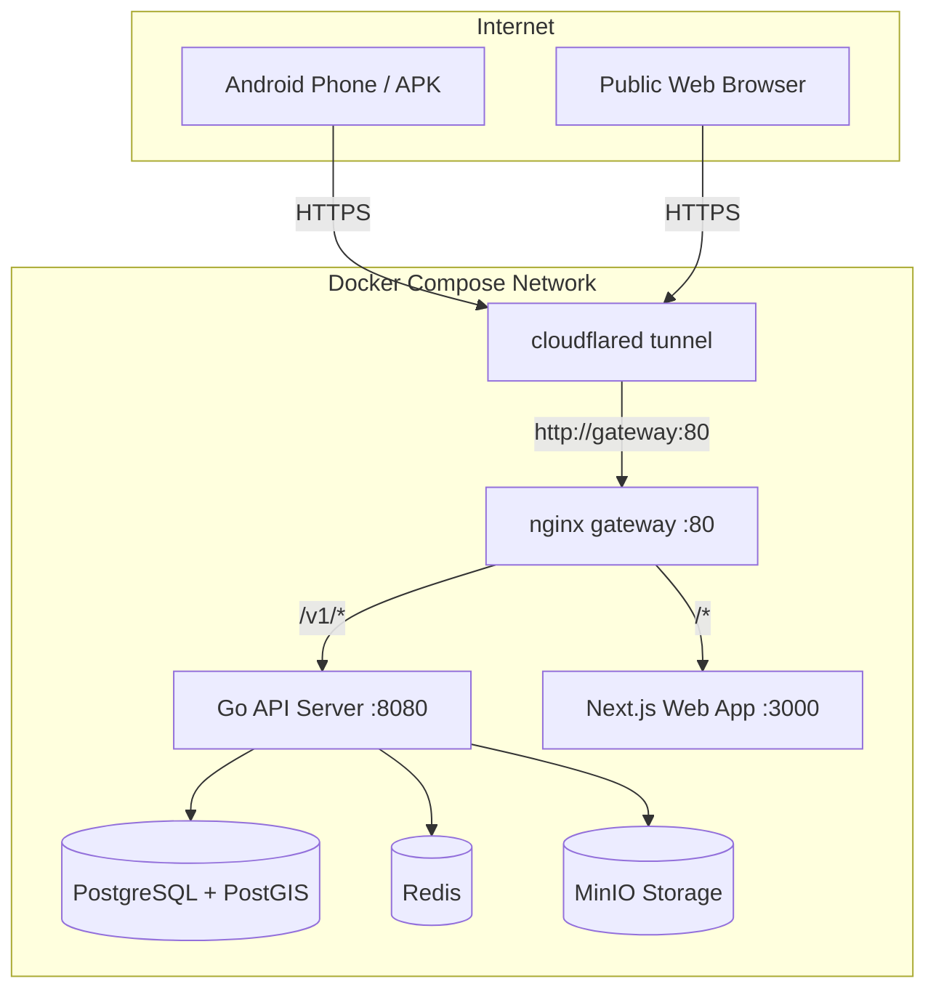

# Design Spec: Docker Compose Stack with Cloudflare Tunnel & Android APK Integration

**Date**: 2026-08-06  
**Status**: Approved  

---

## 1. Overview & Objectives

The goal of this feature is to allow developers to run the entire B2C Marketplace application stack locally using Docker Compose, expose both the Go API backend and Next.js web frontend securely to the public internet via Cloudflare Tunnel (`cloudflared`), and build an Android APK (`mobile-kmm`) configured to connect to the live public endpoint.

---

## 2. Architecture & Components



### 2.1 Docker Services Architecture

1. **Next.js Web Container (`apps/web/Dockerfile`)**:
   - Multi-stage Docker build using `node:22-alpine`.
   - Workspace-aware installation and Next.js standalone build execution.
   - Exposed on internal port 3000.

2. **Reverse Proxy Gateway (`deploy/nginx/nginx.conf`)**:
   - Nginx alpine service listening on port 80.
   - Routes `/v1/` and `/healthz` traffic to `api:8080`.
   - Routes all other web traffic to `web:3000`.

3. **Cloudflare Quick Tunnel (`tunnel` service in `docker-compose.yml`)**:
   - Image: `cloudflare/cloudflared:latest`.
   - Command: `tunnel --no-autoupdate run --url http://gateway:80`.
   - Prints a public HTTPS URL (e.g. `https://xxxx.trycloudflare.com`) directly in Docker logs.

4. **API Service (`services/api`)**:
   - Built using `services/api/Dockerfile`.
   - Connects to Postgres, Redis, and MinIO over Docker internal network.

5. **Database Migration (`migrate` service)**:
   - Runs `golang-migrate` image on container startup against Postgres before API container becomes healthy.

---

## 3. Mobile APK Integration (`apps/mobile-kmm`)

### 3.1 Gradle Configuration (`apps/mobile-kmm/androidApp/build.gradle.kts`)
Modify `buildConfigField` to dynamically read `API_BASE_URL`:

```kotlin
val apiBaseUrl = project.findProperty("API_BASE_URL") as? String
    ?: System.getenv("API_BASE_URL")
    ?: "http://10.0.2.2:8080/v1"

buildConfigField("String", "API_BASE_URL", "\"$apiBaseUrl\"")
```

### 3.2 Automated APK Build Helper (`scripts/build-apk.ps1` & Makefile target)
Provide a helper script/command:
- `make build-apk-tunnel`
- Automatically extracts the `https://*.trycloudflare.com` URL from `docker compose logs tunnel`.
- Executes `./gradlew :androidApp:assembleDebug -PAPI_BASE_URL="https://<tunnel-url>/v1"`.
- Outputs path to compiled APK for easy installation.

---

## 4. Verification Plan

1. Run `docker compose up -d` and confirm all containers (`postgres`, `redis`, `minio`, `api`, `web`, `gateway`, `tunnel`) are in healthy/running state.
2. Fetch Cloudflare tunnel URL from `docker compose logs tunnel`.
3. Verify public backend reachability: `curl -f https://<tunnel-url>/healthz`.
4. Run `make build-apk-tunnel` (or Gradle command with `API_BASE_URL`).
5. Confirm generated `androidApp-debug.apk` exists and compiles without errors.
